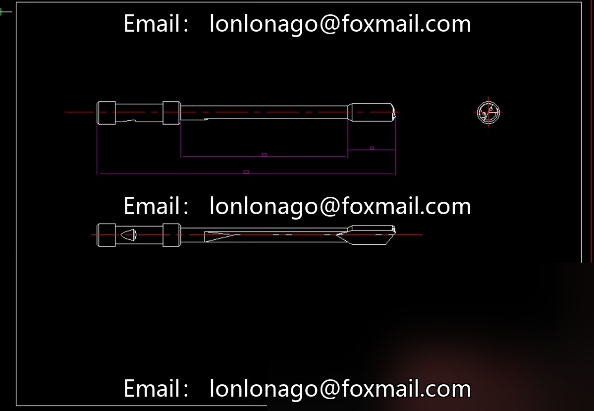
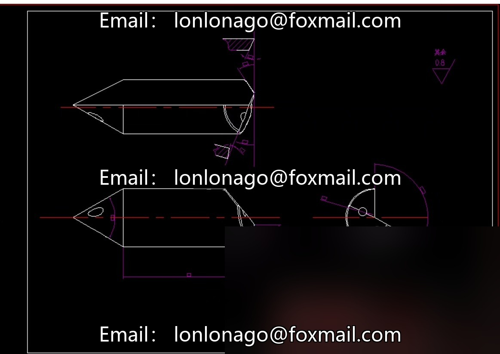

# Mixer design mixer design diagram mixer design CAD diagram

## Body

Mixer design mixer design diagram mixer design CAD diagram
The flocculation tank (usually referred to as the reaction tank) completing the flocculation process plays an important role in water treatment.
Suspended and fleshy substances in natural water have particle sizes that are extremely fine.
To remove these substances, traditionally they are typically achieved by means of concrete curing. In other words, appropriately add coagulants to the original water. After sufficient mixing Imparting colloidal stability against (decomposition of) instability and adsorbing with polymeric substances after coagulation agent water mixing. Making the particles have flocculating performance.
The purpose of the flocculation pond is to create suitable hydraulic conditions so that particles with flocculation properties aggregate through mutual contact, forming larger flocculent bodies (flocs).

Therefore, the appropriateness of the flocculator design relates to the flocculant effect, and the flocculant effect directly affects the subsequent sedimentation effect of subsequent treatment.
The flocculator mixer is a device for mechanical mixing in the flocculator, mainly used for mixing in wastewater treatment.
This design mentions the design of the flocculator, the design of the mixer, and its process flow.
357

The content covers stirrer design diagrams and CAD charts, along with the role of the flocculating pool (reaction pool) in water purification, including the flocculating process, stirrer design and process flow; the images show gun drills, drill handles, drill rods, drill heads, translation documents, tables of contents and task notes.

<!-- AI_ENRICHED -->

## Images

## Payment

Here is a pay link on Stripe ( https://buy.stripe.com/3cs8yP7sY87d0vu9AB ). Please contact me lonlonago@foxmail.com after funding $89, and I will send you a complete data files , thank you!

